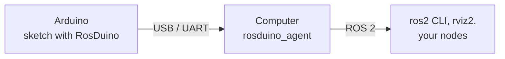

# RosDuino

[Русский](#русский)

**ROS 2 for Arduino.** A sketch on the board publishes, subscribes, and calls services. [`rosduino_agent`](https://github.com/rosduino/rosduino_ros) on the computer turns that board into an ordinary ROS 2 node over USB or UART.



| Repository | What it is |
|---|---|
| [rosduino_arduino](https://github.com/rosduino/rosduino_arduino) | The library. Install the ZIP from [Releases](https://github.com/rosduino/rosduino_arduino/releases). [Русский](https://github.com/rosduino/rosduino_arduino/blob/master/README_RU.md) |
| [rosduino_ros](https://github.com/rosduino/rosduino_ros) | `rosduino_agent` and `rosduino-gen`, the header generator for your own `.msg` and `.srv` files. [Русский](https://github.com/rosduino/rosduino_ros/blob/master/README_RU.md) |

Boards: Arduino Nano, Uno, Micro, Mega 2560, and Due. A simple sketch is about 7 KB of flash and 550 bytes of RAM on a Nano.

The computer needs ROS 2 **Lyrical** (recommended) or **Jazzy**. On Jazzy the board cannot offer a service. Topics, and service calls from the board, still work.

## Start here

1. Install [RosDuino-x.y.z.zip](https://github.com/rosduino/rosduino_arduino/releases) in the Arduino IDE: **Sketch → Include Library → Add .ZIP Library**.
2. Flash **File → Examples → RosDuino → Simple → Led**.
3. On Linux, build the agent and open the same port:

```bash
git clone https://github.com/rosduino/rosduino_ros.git
cd rosduino_ros
source /opt/ros/$ROS_DISTRO/setup.bash
colcon build
source install/setup.bash
ros2 run rosduino_agent rosduino_agent --port /dev/ttyUSB0
```

```bash
ros2 topic pub --once /led std_msgs/msg/Bool "{data: true}"   # the onboard LED turns on
```

License: [Apache-2.0](https://github.com/rosduino/rosduino_arduino/blob/master/LICENSE).

## Русский

**ROS 2 для Arduino.** Скетч на плате публикует и получает сообщения топиков и вызывает сервисы. [`rosduino_agent`](https://github.com/rosduino/rosduino_ros) на компьютере делает эту плату обычным узлом ROS 2 по USB или UART.

| Репозиторий | Что это |
|---|---|
| [rosduino_arduino](https://github.com/rosduino/rosduino_arduino/blob/master/README_RU.md) | Библиотека. ZIP для Arduino IDE лежит в [релизах](https://github.com/rosduino/rosduino_arduino/releases). |
| [rosduino_ros](https://github.com/rosduino/rosduino_ros/blob/master/README_RU.md) | `rosduino_agent` и `rosduino-gen` — генератор заголовков для своих `.msg` и `.srv`. |

Платы: Arduino Nano, Uno, Micro, Mega 2560 и Due. Простой скетч занимает около 7 КБ flash и 550 байт RAM на Nano.

На компьютере нужен ROS 2 **Lyrical** (рекомендуется) или **Jazzy**. На Jazzy плата не может предоставить сервис. Топики и вызовы сервисов с платы работают.

1. Установите [RosDuino-x.y.z.zip](https://github.com/rosduino/rosduino_arduino/releases): **Sketch → Include Library → Add .ZIP Library**.
2. Прошейте **File → Examples → RosDuino → Simple → Led**.
3. На Linux соберите агент и откройте тот же порт, что и IDE. Команды те же, что в английском разделе выше.

```bash
ros2 topic pub --once /led std_msgs/msg/Bool "{data: true}"   # светодиод на плате загорелся
```

Лицензия: [Apache-2.0](https://github.com/rosduino/rosduino_arduino/blob/master/LICENSE).